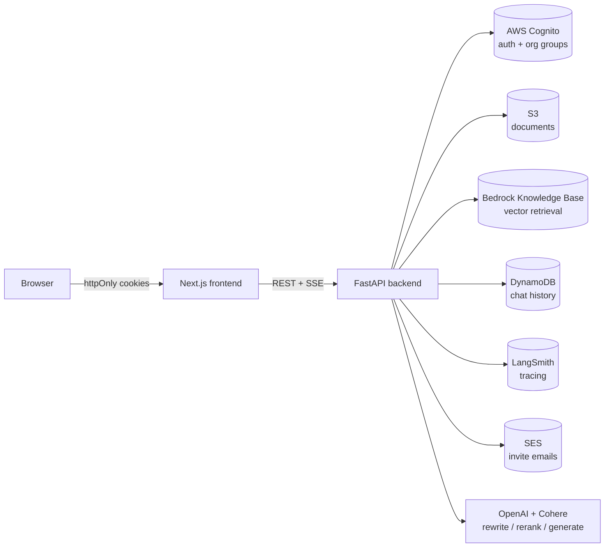

# Enterprise RAG Bedrock

A multi-tenant Retrieval-Augmented Generation SaaS platform built on **AWS Bedrock Knowledge Base**, with real authentication, per-organization admin roles, per-document access control, persistent chat history, and full observability.

Backend: **FastAPI** (Python 3.11, Poetry). Frontend: **Next.js 14** (App Router, TypeScript, Tailwind CSS).

---

## What this is

Every organization ("tenant") shares one Bedrock Knowledge Base, but never sees another tenant's documents. Within an organization, the person who created it is its **admin** — only they can upload documents, invite teammates, and choose which specific documents each teammate can access. Every query is traced end-to-end (retrieval, reranking, generation) so an admin can see cost, latency, and error diagnostics per organization from a dashboard, without touching AWS consoles.

## Architecture



A single query (`POST /chat/query`) runs: **input guardrail check → query rewrite (resolves "it"/"that" from history) → HyDE passage generation → Bedrock KB retrieve (tenant + sharing filtered) → Cohere rerank → streamed LLM answer**, with the whole pipeline captured as one LangSmith trace.

## Core concepts

### Multi-tenancy: Cognito Groups

There is no `tenant_id` column anywhere — a **Cognito Group** *is* the tenant. Signing up with an `org_slug` either creates a brand-new group (you become its founder) or, since org-slug guessing was a real security gap early on, joining an *existing* org now **requires a signed invite link** — typing a slug alone no longer works. Every request's tenant is derived from the caller's verified Cognito IdToken, never from anything the client claims.

### Per-org admin (RBAC)

The org's founder is also added to a second, parallel group, `{org_slug}-admins`. A user's role is resolved as: *tenant* = the one non-`-admins` group they're in; `is_admin` = whether they're **also** in that group's admin companion. This piggybacks on the existing group-per-tenant model instead of adding a separate roles table. Admins can invite teammates, upload/delete/share documents, suspend a specific member, and view the org's diagnostics — regular members are read-only consumers of whatever's been shared with them.

### Retrieval isolation (tenant + per-document sharing)

Every uploaded file gets a `.metadata.json` sidecar (`tenant_id`, `uploaded_by`, optionally `shared_with`) that Bedrock KB attaches to every chunk it indexes. `retrieve_from_kb` builds a metadata filter accordingly:

- **Admin**: `tenant_id == org` — sees everything in their org, full stop.
- **Member**: `tenant_id == org AND (uploaded_by == me OR shared_with contains me)` — sees only documents explicitly shared with them.

A missing/absent metadata attribute simply fails to match, which is the fail-safe direction (under-retrieval, never cross-tenant or cross-permission leakage). One sharp edge worth knowing if you touch this code: **Bedrock KB rejects a `STRING_LIST` metadata attribute whose value is an empty list** (fails ingestion for the *entire* document, not just that field) — so "shared with no one" is represented by omitting the `shared_with` key entirely, never writing `[]`.

### Org invites

An admin generates a stateless, HMAC-signed, 7-day token (`{org_slug, expiry}` + signature — no database row) via `POST /admin/invites`. If AWS SES is configured with a verified sender, the backend emails the invitee a join link directly; if sending fails for any reason (including SES sandbox mode rejecting an unverified recipient), the admin still gets the link on-screen to send manually — the feature degrades gracefully rather than blocking on email infrastructure.

### Observability

Every pipeline stage (`rewrite_query`, `generate_hyde_passage`, `retrieve_from_kb`, `rerank_with_cohere`, the guardrail check, the final generation) is `@traceable`, and the root trace is tagged with `tenant_id`/`user_id` metadata at runtime (`get_current_run_tree()` — the `config={"metadata": ...}` kwarg does *not* work for this, confirmed the hard way). The admin dashboard (`/admin/stats`, `/admin/errors`, `/admin/users`) queries LangSmith directly for cost, p50/p95 latency, error rate, and a per-member cost breakdown — no separate metrics store to maintain.

## Project structure

```
enterprise-rag-bedrock/
├── backend/                    FastAPI service (Poetry-managed)
│   └── app/
│       ├── api/                 Route handlers (auth, chat, documents, conversations, admin)
│       ├── services/            Business logic — one *_service.py per external system
│       ├── models/               Pydantic request/response schemas
│       ├── core/                 Config, AWS client factories, auth dependency
│       └── utils/
├── frontend/                    Next.js 14 (App Router) + TypeScript + Tailwind CSS
└── docker-compose.yml            Local dev orchestration
```

## Getting started

### Prerequisites

An AWS account with a **Bedrock Knowledge Base** (Quick Create / managed, S3 as its data source), an **S3 bucket**, a **Cognito User Pool** with a confidential app client, and **DynamoDB** tables for chat history. Cohere and OpenAI API keys for reranking/generation.

### Backend

```bash
cd backend
poetry install
cp .env.example .env   # fill in the values below
poetry run uvicorn app.main:app --reload
```

Health check: `GET http://localhost:8000/health` → `{"status": "ok"}`

Run tests: `poetry run pytest`

### Frontend

```bash
cd frontend
npm install
npm run dev
```

Runs at `http://localhost:3000`.

### Docker Compose

```bash
docker compose up --build
```

- Backend: `http://localhost:8000`
- Frontend: `http://localhost:3000`

## Environment variables (`backend/.env`)

| Variable | Purpose |
|---|---|
| `AWS_REGION`, `AWS_ACCESS_KEY_ID`, `AWS_SECRET_ACCESS_KEY` | AWS credentials for every service below |
| `BEDROCK_KB_ID` | Knowledge Base ID — retrieval source for `/chat/query` |
| `S3_BUCKET_NAME` | Bucket backing the Knowledge Base's data source and document storage |
| `COHERE_API_KEY` | Reranking (`retrieval_service.rerank_with_cohere`) |
| `OPENAI_API_KEY` | Query rewriting, HyDE, and final answer generation |
| `OPENSEARCH_ENDPOINT` | Only needed for the standalone hybrid-retrieval path below — unused by default |
| `BEDROCK_GUARDRAIL_ID`, `BEDROCK_GUARDRAIL_VERSION` | Optional prompt-injection/content guardrail; blank disables it (no-op) |
| `COGNITO_USER_POOL_ID`, `COGNITO_APP_CLIENT_ID`, `COGNITO_APP_CLIENT_SECRET`, `COGNITO_REGION` | Auth — every request's tenant/role comes from here, never a client header |
| `COOKIE_SECURE` | `False` for local http dev; `True` once served over https |
| `DYNAMODB_CONVERSATIONS_TABLE`, `DYNAMODB_MESSAGES_TABLE` | Per-user chat history (conversations are private; documents are shared per-org) |
| `LANGCHAIN_TRACING_V2`, `LANGCHAIN_API_KEY`, `LANGCHAIN_PROJECT` | LangSmith tracing — blank/`false` makes every `@traceable` call a no-op |
| `REDIS_URL`, `RATE_LIMIT_ENABLED` | Shared Redis backend and explicit switch for distributed API rate limiting |
| `RATE_LIMIT_WINDOW_SECONDS`, `TENANT_REQUESTS_PER_WINDOW`, `USER_REQUESTS_PER_WINDOW` | Authenticated tenant/user fixed-window limits |
| `AUTH_IP_REQUESTS_PER_WINDOW`, `TRUSTED_PROXY_CIDRS` | Authentication abuse limit and proxies allowed to supply `X-Forwarded-For` |
| `INVITE_SIGNING_KEY` | Random secret (`python -c "import secrets; print(secrets.token_hex(32))"`) signing invite tokens |
| `SES_SENDER_EMAIL`, `FRONTEND_BASE_URL` | Email-delivered invites — verified SES sender + the origin used to build join links |

When rate limiting is enabled, authenticated requests consume both a tenant
bucket and a tenant/user bucket atomically. Signup, login, password and token
endpoints use a separate client-IP bucket. Limit responses return `429` with
`Retry-After`; an unavailable Redis backend returns `503` instead of silently
bypassing protection. `X-Forwarded-For` is honored only for peers listed in
`TRUSTED_PROXY_CIDRS`.

## Retrieval architecture

`/chat/query` retrieves context from the **Bedrock Knowledge Base** (`retrieve_from_kb` in `bedrock_kb_service.py`); chunking, embedding, and indexing happen inside Bedrock when you call `POST /documents/sync-kb`. See [Retrieval isolation](#retrieval-isolation-tenant--per-document-sharing) above for exactly how tenant and sharing scoping works.

The codebase also has a **standalone hybrid retrieval path** (`chunking_service.py` → `ingestion_service.py` → `retrieval_service.py`: dense + BM25 + RRF fusion against a self-managed OpenSearch index, via `POST /documents/{id}/ingest`) that isn't currently wired into `/chat/query` — kept as an alternative if you provision a real OpenSearch domain/collection later.

## API reference

### Auth (`/auth`)

| Endpoint | Purpose |
|---|---|
| `POST /auth/signup` | Create a brand-new org (fails if the slug is taken — see [Multi-tenancy](#multi-tenancy-cognito-groups)) |
| `POST /auth/join` | Join an *existing* org via a validated invite token |
| `GET /auth/invite-preview` | Resolve a token to its org name, before submitting the join form |
| `POST /auth/confirm` | Confirm signup with the emailed code |
| `POST /auth/login` / `POST /auth/refresh` / `POST /auth/logout` | Session management (httpOnly cookies) |
| `GET /auth/me` | Current session's user/org/role |
| `POST /auth/forgot-password` / `POST /auth/reset-password` | Password reset |

### Chat (`/chat`, `/conversations`)

| Endpoint | Purpose |
|---|---|
| `POST /chat/query` | Ask a question — streams the answer via Server-Sent Events, persists to history |
| `GET /conversations` / `GET /conversations/{id}` / `DELETE /conversations/{id}` | Per-user chat history |

### Documents (`/documents`) — upload/delete/share are admin-only

| Endpoint | Purpose |
|---|---|
| `POST /documents/upload` | Upload a PDF/DOCX to S3 (admin only) |
| `GET /documents` | List documents visible to the caller (all, for an admin; shared-with-me, for a member) |
| `DELETE /documents/{id}` | Delete a document (admin only) |
| `GET/PUT /documents/{id}/shares` | View/set exactly which members can access a document (admin only) |
| `POST /documents/sync-kb` | Trigger a Bedrock KB ingestion job (chunk + embed + index) |
| `POST /documents/{id}/ingest` | Alternative path: index into the standalone OpenSearch pipeline |

### Admin (`/admin`) — all endpoints require the caller to be an org admin

| Endpoint | Purpose |
|---|---|
| `GET /admin/stats` | Org-wide query count, cost, p50/p95 latency, error rate |
| `GET /admin/errors` | Recent failed queries, each linking to its LangSmith trace |
| `POST /admin/errors/{run_id}/retry` | Re-run a failed query as a smoke test (never writes to anyone's chat history) |
| `GET /admin/users` | Org members + per-member cost/query breakdown |
| `POST /admin/users/{sub}/suspend` / `unsuspend` | Disable/re-enable a member's account |
| `POST /admin/invites` | Generate (and, if SES is configured, email) an invite link |
