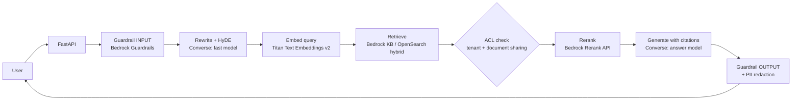

# Bedrock architecture and talking points

## One-line pitch

A multi-tenant enterprise RAG service on AWS. Bedrock handles generation,
embeddings, reranking and content safety; every retrieved chunk is checked
against the caller's document ACL **before** it reaches the model.

## Request flow

## Where each Bedrock feature is used

| Feature | Where | Config |
|---|---|---|
| Converse API (Claude / Nova) | answer, rewrite, HyDE, admin copilot, error watchdog | `LLM_PROVIDER=bedrock`, `BEDROCK_FAST_MODEL_ID`, `BEDROCK_ANSWER_MODEL_ID` |
| Titan Text Embeddings v2 | indexing and query embedding | `EMBEDDING_PROVIDER=bedrock` |
| Rerank API | after retrieval | `RERANK_PROVIDER=bedrock` |
| Guardrails (`ApplyGuardrail`) | user query and generated answer | `BEDROCK_GUARDRAIL_ID`, `GUARDRAIL_FAIL_MODE`, `GUARDRAIL_REQUIRED` |
| Knowledge Bases | managed retrieval path and ingestion sync | `BEDROCK_KB_ID` |
| Tool use | admin copilot (read-only tools, fixed tenant) | via Converse |

Every provider switch defaults to the previous behavior, so each can be turned
on and compared (RAGAS eval) independently.

## Design decisions worth explaining

- **Authorize before generate.** Retrieved evidence is filtered by tenant and
  document sharing first; the model never sees a chunk the user can't read.
- **Provider-agnostic model layer.** `app/core/llm.py` hides the vendor, so
  Claude, Nova or another Converse model is a config change.
- **Guardrail failure policy is explicit.** `open` keeps chat available if
  the guardrail call errors; `closed` blocks instead. `GUARDRAIL_REQUIRED`
  refuses to boot without a guardrail.
- **Different index per embedding model.** A `knn_vector` dimension can't
  change in place, so Titan uses its own index and a re-ingest.
- **Rerank has its own region.** The Rerank API isn't offered in every region.

## Honest status

| Piece | Code | Verified against live Bedrock |
|---|---|---|
| Converse LLM layer | done, unit-tested | not yet |
| Rerank | done, unit-tested | not yet |
| Titan embeddings | done, unit-tested | not yet |
| Guardrails (fail mode, required) | done, unit-tested | not yet |
| `scripts/create_guardrail.py` | written | not run |

Live verification is blocked by account setup (AWS India Marketplace payment
rules and zero default Bedrock quotas), not by the code. Update this table
once the calls have run, and add the RAGAS comparison (OpenAI vs Bedrock).

## Likely questions

- **Why Converse instead of InvokeModel?** One request/response shape and tool
  use across model families, so swapping models doesn't change application code.
- **How do you stop prompt injection through documents?** Retrieved text is
  framed as untrusted data, scanned, the model is told not to obey it, and the
  output goes through Guardrails and PII redaction.
- **Why not Knowledge Bases only?** KB is the managed path; the custom hybrid
  path gives control over fusion and ACL filtering. Both are kept so the
  trade-off can be measured.
- **How do you know the migration didn't hurt quality?** Run the same RAGAS
  eval set on each provider setting and compare before switching defaults.
- **What does it cost?** Pay per token; start with the smaller model for
  rewrite/HyDE and the larger one only for the final answer.
